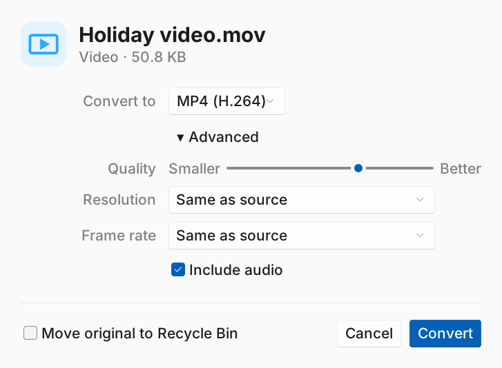

# Convert for Windows

Right-click files in File Explorer, choose **Convert…**, pick a format. Audio, video, images, documents and PDFs.
Everything runs on your PC; nothing is uploaded.

A Windows port of [Convert for macOS](https://github.com/newtonstudios/convert) by eliasdesena.

## Download and install

1. Open the **[latest release](../../releases/latest)** and download `Convert-Windows.zip`.
2. Extract it somewhere permanent (for example `C:\Users\<you>\Convert`), then run **`Convert.exe`**.
3. Click **Install** in the window. That adds **Convert…** to the right-click menu (current user only, no admin rights).
4. For audio and video, click **Install ffmpeg** when the window offers it, or run `winget install Gyan.FFmpeg`.

**Windows 11:** the entry is under **Show more options** (or select the files and press **Shift+F10**).
**Moved the folder?** Click Install again so the menu points to the new location.

**"Windows protected your PC" (SmartScreen)?** The exe isn't code-signed, because certificates cost money. Click
*More info → Run anyway*. Some antivirus tools also distrust unsigned PyInstaller apps. If you'd rather not trust a
binary, the source is right here: build it yourself (see below).

## What it converts

| | Formats |
|---|---|
| Audio | MP3, M4A (AAC), WAV, AIFF, FLAC, ALAC, Opus, OGG, WMA, AC3, WavPack, MP2 |
| Video | MP4 (H.264 / HEVC / AV1), MOV (ProRes), WebM, MKV, animated GIF, or extract the audio |
| Images | JPEG, PNG, HEIC, AVIF, WebP, TIFF, GIF, BMP, PDF (RAW photos with the optional `rawpy`) |
| Documents | PDF, DOCX, DOC, ODT, RTF, TXT, HTML. Markdown works as a source |
| PDF → | PNG / JPEG (one per page), plain text |

Output goes next to the original (`name.mp3`, then `name 2.mp3`…). Per-format settings are remembered. A batch runs in
one window with a Stop button. "Move original to Recycle Bin" only happens after the new file exists. Choose **Text size**
in the *Convert* menu (or Ctrl+plus / Ctrl+minus) if the text is too small on a high-resolution screen.

## What each feature needs

| Feature | Needs | Notes |
|---|---|---|
| Images, PDF → images/text | nothing extra | built in |
| TXT, Markdown, HTML, DOCX → TXT or HTML | nothing extra | built in |
| Audio, video | **ffmpeg** | one-click button in the app, or `winget install Gyan.FFmpeg` |
| Anything → **PDF** | **Edge** (already on Windows), Chrome, or LibreOffice | |
| → DOCX / ODT / RTF, and ODT / RTF → anything | **LibreOffice** or **Pandoc** | |
| **DOC** (old Word) in or out | **LibreOffice** | `winget install TheDocumentFoundation.LibreOffice` |

The window tells you before you click Convert if something is missing. *Convert → Tool check…* lists what was found.

GPU video encoding (NVIDIA, Intel, AMD) turns on automatically if your GPU supports it. The checkbox is under
**Advanced**. If a GPU encode fails, the file is retried on the CPU.

## Good to know

- **Paper size** (A4 / Letter) applies to text, Markdown and HTML sources. Word, ODT and RTF files keep their own page size.
- Markdown images aren't rendered (alt text only), and raw HTML inside Markdown is ignored.
- HTML → PDF blocks network access, so remote images in your HTML won't load.
- Windows hides classic right-click entries when more than about 15 files are selected. For bigger batches, drag the
  files onto the Convert window.
- Not supported (Mac-only formats): `.webarchive`, `.rtfd`.

## Tested on

Windows 11 with a 4K display at 150% scaling and an NVIDIA RTX 5080:

- right-click menu, including several files selected at once
- HEIC → PNG, PDF → JPG, MP4 → MP3, MP3 → FLAC, TXT → PDF
- Recycle Bin option, Stop button, NVIDIA GPU encoding, text size on a high-DPI screen

Not yet verified on real hardware: Intel and AMD GPU encoders, RAW photos, and Word / ODT / RTF / DOC conversions
(which need LibreOffice or Pandoc). If you try those, please [open an issue](../../issues) either way.

## Credits and license

- **Original macOS app:** [eliasdesena](https://github.com/newtonstudios/convert), MIT licensed.
- **Windows port:** Tobias Hoffmann, developed with the help of Claude (Anthropic).

MIT licensed. See [LICENSE](LICENSE). ffmpeg, LibreOffice, Pandoc and the other tools are installed separately and keep
their own licenses.
